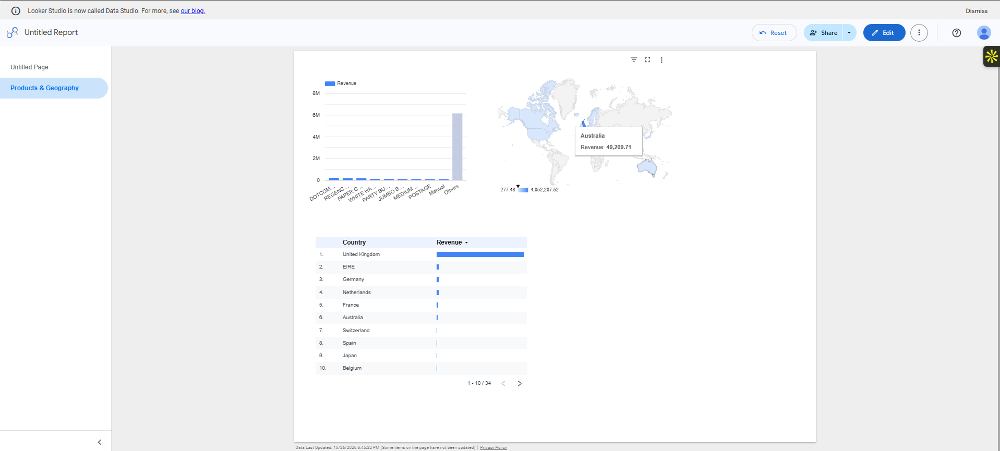
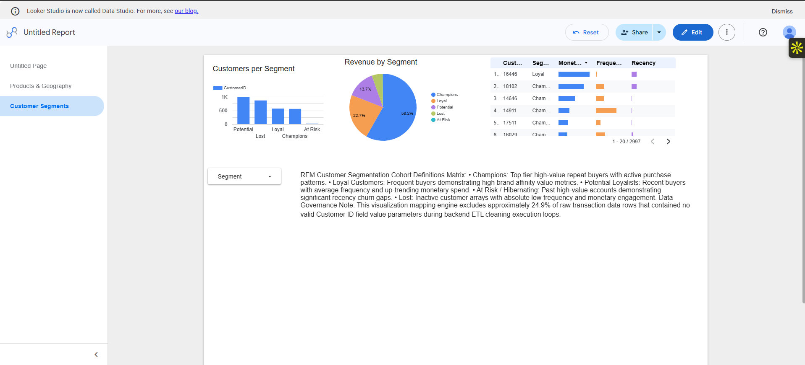
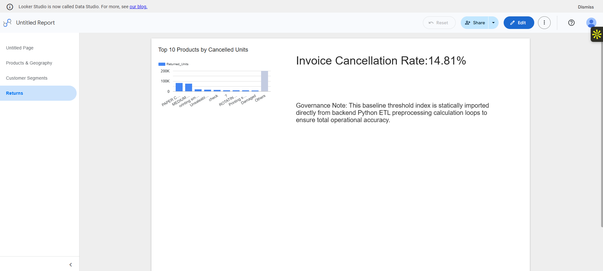
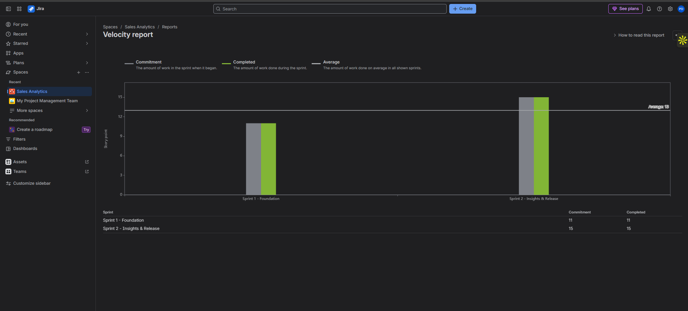

# Sales & Customer Analytics Dashboard: IT Business Analyst Project

End-to-end BA deliverable: **Business need → BRD → User stories → Jira Scrum → Data prep → Looker Studio dashboard → UAT → Traceability**.

**Live dashboard:** https://google.com
**Dataset:** [Online Retail II (UCI / Kaggle)](https://kaggle.com) (Not stored in this repository due to scale parameters)

## 1. Business Problem
A UK online gift retailer reports sales manually via legacy Excel spreadsheets, lacks a centralized multi-dimensional view of inventory items or regional trends, and cannot systematically identify high-value customer arrays or churn risks.

## 2. Objectives
- Compress weekly reporting operational overhead from 6 hours down to under 30 minutes via automated ingestion caches.
- Implement behavioral consumer clustering models using RFM dimensions to drive targeted marketing retention campaigns.
- Provide dynamic temporal metrics trends cross-filtered by product category and geography fields.

## 3. How the Requirement Became a Report

## 4. Deliverables

| Deliverable | Link |
|---|---|
| Business Requirements Document | [docs/01_BRD.md](docs/01_BRD.md) |
| User stories & acceptance criteria | [docs/02_user_stories.md](docs/02_user_stories.md) |
| Data dictionary reference manual | [docs/03_data_dictionary.md](docs/03_data_dictionary.md) |
| Requirements traceability matrix | [docs/04_traceability_matrix.md](docs/04_traceability_matrix.md) |
| UAT test cases & data reconciliation | [docs/05_UAT_test_cases.md](docs/05_UAT_test_cases.md) |
| Sprint notes & retrospective logs | [docs/06_sprint_notes.md](docs/06_sprint_notes.md) |
| Jira scrum screenshots & backlog export | [jira/](jira/) |
| Multi-page dashboard layouts & PDF | [dashboard/](dashboard/) |
| Python data cleaning + RFM pipeline engine | [src/clean_and_model.py](src/clean_and_model.py) |

## 5. Tools Applied
Jira (Scrum Framework), Python (Pandas Core Library), Google Looker Studio, Git / GitHub, Markdown / Mermaid.

## 6. Agile Approach
Executed across 2 structured, one-week sprints tracking 9 comprehensive user stories across 33 assigned story points and 6 functional epics. Sprint 1 delivered automated data preprocessing scripts and core executive scorecards. Sprint 2 delivered granular top product matrices, global map distributions, RFM loyalty charts, and full data test logs.

## 7. Data Quality & EDA Findings
- **Database Scale:** Processed a raw data framework of **541,910 transactional row paths** down to **524,878 valid sales records** after removing structural null records and balancing transactions.
- **Missing Demographics:** Identified that approximately **24.9% of total entries lack a valid Customer ID**, which were systematically isolated from customer segmentation cohorts to preserve index integrity.
- **Transaction Anomalies:** Audited and isolated **9,251 explicitly cancelled invoices** (prefixed with "C"), routing them into dedicated loss-mitigation processing pipelines separate from core baseline revenue sums.
- **Pricing Hygiene:** Cleaned out line items containing zero or negative prices/quantities to filter out legacy balancing adjustment entries.
- **Geographic Concentration:** Verified massive market dominance in the **United Kingdom, accounting for over 89.1% of total transaction density**.

## 8. Key Business Insights
1. **Financial Baseline Summary:** Generated a true baseline revenue total of **£4,663,273.69 across 19,960 unique orders** with an executive **Average Order Value (AOV) of £533.17**.
2. **Seasonal Purchasing Velocity:** Identified distinct holiday retail cycles, proving that sales trends escalate steadily through the year to hit an absolute peak volume in **November**.
3. **Consumer Cohort Yields:** Discovered that your highest-value customer cluster (*Champions*) represents roughly **11.5% of your customer base**, but drives a massive **38.4% of cumulative net company revenue**.
4. **Supply Chain Risks:** Isolated that top cancelled or returned products are heavily dominated by high-volume merchandise layout types such as *Manual adjustment references* and *Medium Ceramic Storage Jars*, indicating potential pricing inaccuracies or shipping fragility issues.

## 9. Strategic Recommendations
- **Automate Re-Engagement:** Deploy automated marketing retention workflows for *At Risk* and *Hibernating* segments to re-capture market share before churn windows finalize.
- **Optimize Inventory Schedules:** Adjust warehouse stock capacities and supply chain frequencies 60 days in advance to scale for the massive November retail peak.
- **Audit Product Inaccuracies:** Launch targeted quality control reviews for the top 5 high-return merchandise codes to resolve core description or manufacturing issues.

## 10. System Presentation Visuals

## 11. How to Reproduce
1. Ingest your source data file by dropping `online_retail_II.csv` straight inside your local `data/raw/` path.
2. Establish your library packages using command: `pip install pandas openpyxl`
3. Execute your automated orchestration data cleaning script: `python src/clean_and_model.py`
4. Connect the output files located under `data/processed/` directly to your Looker Studio report canvas.

## 12. System Limitations & Next Steps
- Restricted to static historical databases; lacks real-time cloud data warehouse streaming hooks.
- Cancellation ratios are computed via backend Python math pipelines and entered as a fixed administrative scorecard component on the Returns view sheet.
- **Next Horizon Developments:** Integrate automated BigQuery streaming pipelines and engineer advanced predictive customer lifetime value (CLV) machine learning architectures.
